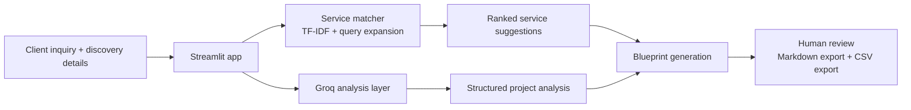
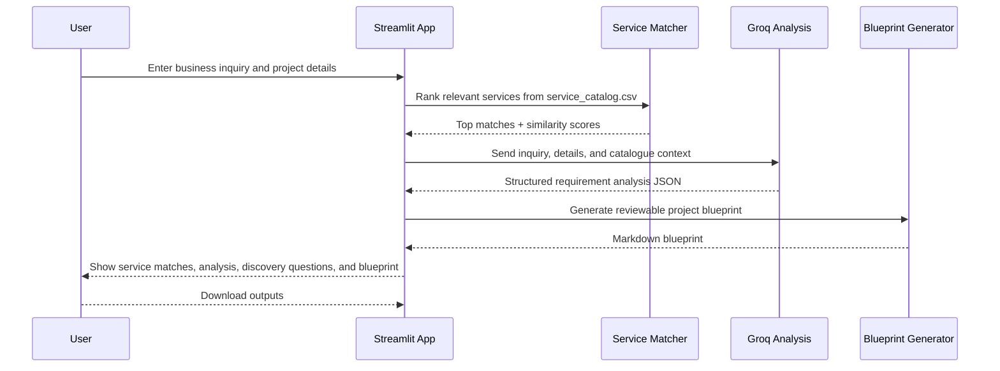

# Cynbit AI Inquiry-to-Blueprint Assistant

A locally runnable proof-of-concept application that takes a business inquiry, matches it to a curated catalogue of services, and produces a human-reviewed preliminary blueprint for discussion and discovery.

## Project overview

This repository contains a Streamlit-based assistant for exploring and structuring early-stage client requirements. The application is designed for internal discovery work and project framing, not as a production product, final quote engine, or live customer-facing deployment.

It combines:
- a transparent TF-IDF service matching engine,
- a Groq-powered requirement analysis step,
- a generated project blueprint intended for human review,
- downloadable outputs for services and blueprint markdown.

## Problem statement

Teams often receive unstructured or incomplete business inquiries and need a quick way to:
- identify likely relevant services,
- surface missing information before discovery,
- summarize requirements in a clear, reviewable blueprint,
- avoid hardcoding assumptions or fabricated staffing details.

This project addresses that workflow in a lightweight, explainable way using a curated catalogue and structured prompts.

## Objectives

1. Turn a raw client inquiry into a structured discovery brief.
2. Match the inquiry against known catalogued services using transparent text-similarity scoring.
3. Highlight missing business information and required validation questions.
4. Generate a preliminary blueprint suitable for consultant review.
5. Keep outputs clearly provisional and non-binding.

## Key features

- Inquiry form with structured business context fields.
- TF-IDF-based service ranking with query expansion for common client terms.
- Discovery checks for budget, data availability, integration, sensitivity, and timeline.
- Groq-powered analysis using a grounded prompt and schema validation.
- Human-review warning labels throughout the generated blueprint.
- Downloadable service match CSV and blueprint Markdown output.
- Safe handling for missing or invalid Groq configuration.
- Sanitization to reduce fabricated vendor, staffing, and budget claims in generated content.

## Technology stack

- Python 3
- Streamlit
- pandas
- scikit-learn
- Groq API
- python-dotenv
- pytest

## System architecture



## Application workflow



## Project structure

```text
.
├── app.py                     # Streamlit application entry point
├── requirements.txt          # Python dependencies
├── README.md                 # Project documentation
├── .env.example              # Sample environment variables
├── .gitignore                # Git ignore rules for secrets and generated files
├── DATASET_README.md         # Dataset and evaluation notes
├── DATASET_VALIDATION_SUMMARY.json
├── AI_Opportunity_Report.md
├── evaluate_model.py
├── evaluate_unseen.py
├── evaluation_results.csv
├── unseen_evaluation_results.csv
├── service_catalog.csv
├── service_catalog.backup.csv
├── synthetic_inquiries.csv
├── opportunity_matrix.csv
├── reports/
│   ├── AI_Opportunity_Report.md
│   └── TECHNICAL_APPROACH_REPORT.md
├── src/
│   ├── __init__.py
│   ├── blueprint.py
│   ├── llm_service.py
│   ├── service_matcher.py
│   └── service_matcher.backup.py
├── tests/
│   └── test_service_matcher.py
├── screenshots/
│   └── README.md
└── .venv/                    # Local virtual environment, ignored by Git
```

## Installation and setup

### 1. Clone the repository

```bash
git clone <repository-url>
cd cynbit-ai-inquiry-blueprint
```

### 2. Create a virtual environment

Windows PowerShell:

```powershell
py -m venv .venv
.\.venv\Scripts\Activate.ps1
```

macOS/Linux:

```bash
python3 -m venv .venv
source .venv/bin/activate
```

### 3. Install dependencies

```bash
python -m pip install --upgrade pip
pip install -r requirements.txt
```

### 4. Configure Groq credentials

Copy the example environment template and add your local values:

```bash
copy .env.example .env
```

Then edit `.env` and set the required value(s):

```env
GROQ_API_KEY=your_groq_api_key_here
GROQ_MODEL=openai/gpt-oss-120b
```

Important:
- Never commit `.env` to source control.
- Keep API keys in local environment variables only.
- `GROQ_MODEL` is optional if the default model is acceptable.

## Groq API configuration using .env.example

This repository includes a placeholder-only `.env.example` file for local configuration.

Example:

```env
GROQ_API_KEY=your_groq_api_key_here
GROQ_MODEL=openai/gpt-oss-120b
```

This file must never contain a real key or production credential.

## How to run the application

With the virtual environment activated:

Windows PowerShell:

```powershell
.\.venv\Scripts\python.exe -m streamlit run app.py
```

Or, if the environment is active in the shell:

```bash
streamlit run app.py
```

The app will start in the local browser, typically at:

```text
http://localhost:8501
```

The project was validated locally at `http://localhost:8502` during testing, so the actual local port may vary depending on environment and prior sessions.

## How to run automated tests

From the project root:

```bash
pytest -q
```

This repository currently includes automated checks in `tests/test_service_matcher.py` for matching behavior, formatting, Groq safety, and edge-case handling.

## Data and responsible-use notes

- `service_catalog.csv` contains summary-level service data used for matching and demonstration.
- `synthetic_inquiries.csv` contains synthetic example inquiries for evaluation and testing.
- Matching scores are similarity indicators, not probabilities, confidence scores, or proven performance metrics.
- Generated outputs are provisional, intended for human review, and not final quotes or delivery commitments.
- The project should not be used with confidential client data or production CRM records without review.

## Limitations and future scope

This repository is a proof of concept and has the following constraints:

- TF-IDF matching is lexical and explainable, but not a semantic or production ranking system.
- Groq integration depends on a valid API key and network access.
- The application is designed for local demonstration and exploratory discovery.
- Catalog content should be validated with the business or product team before being treated as authoritative.
- Production readiness would require authentication, access control, logging, data handling review, and explicit stakeholder approval.

Future improvements could include:
- improved semantic retrieval or embeddings-based ranking,
- richer blueprint generation tailored to client-specific discovery output,
- stronger validation of generated content,
- user authentication and secure deployment patterns,
- integration with enterprise knowledge sources, CRM systems, and workflow tools.

## Screenshots

The repository includes a screenshots folder with instructions for capturing final demonstration images without fabricating them.

See: `screenshots/README.md`

## Repository status

This project is provided for demonstration, evaluation, and internal review. It is not a production deployment and should not be presented as a live service, production system, or business impact claim without explicit review.
